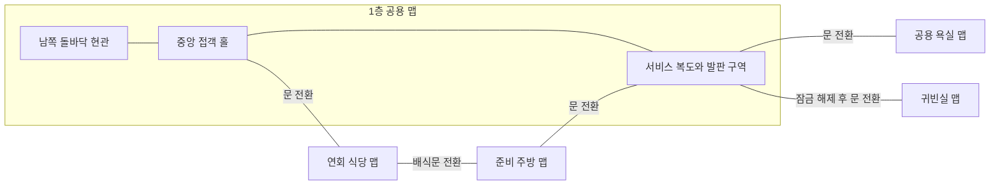

# 별장 1층 배치 제안

이 문서는 배치 확정 전의 설계안입니다. 치수와 배치는 임시 제안이며, 실제 이동 가능한 맵 구현은 배치 확정 후 진행합니다.

## 현재 코드 확인

- src/world.py에 화면 800×600px, 플레이어 충돌 반경 12px, 이동 속도 200px/s와 사각형 벽 8개가 정의되어 있습니다.
- 충돌은 플레이어 중심을 기준으로 한 24×24px 사각형과 벽의 겹침을 검사합니다.
- src/player.py는 X축과 Y축을 따로 검사하므로 벽을 따라 미끄러지듯 이동할 수 있습니다. 대각선 속도는 정규화합니다.
- src/game.py는 고정 화면에 벽과 임시 플레이어를 그립니다. 카메라 스크롤, 방 전환, 가구 충돌, 문 상태, 관측 판정, Watcher와 발판 로직은 개발 예정입니다.
- 기존 타일 규격과 외부 맵 데이터는 없습니다. data/maps와 assets/images/tiles는 준비된 폴더입니다.
- 현재 소스코드를 읽어 확인했으며 이번 작업에서 게임을 실행하거나 이동을 검증하지는 않았습니다.

## 제안 규격

- 타일 한 칸을 32×32px로 제안합니다. 현재 캐릭터 충돌 폭 24px가 한 칸 안에 들어갑니다.
- 문 통과 폭은 최소 2칸인 64px, 좁은 복도의 유효 폭은 3칸인 96px로 잡습니다.
- 수치는 벽과 가구의 충돌 영역을 제외한 통행 폭입니다.
- 기존 1254×1254px 캐릭터 시트는 원본 이미지 크기입니다. 타일 크기와 게임 내 캐릭터 표시 크기는 별도로 결정합니다.
## 맵 전환 구조

1층 공용 맵에 현관, 접객 홀, 서비스 복도를 연속된 공간으로 배치합니다. 세 공간은 걸어서 이동합니다. 공용 맵에는 식당, 주방, 욕실, 귀빈실의 출입문만 배치합니다. 방 내부의 바닥, 벽, 가구와 충돌 영역은 각 방의 독립 맵에 둡니다.

- 문을 통과하면 목적지 맵의 해당 문 안쪽에서 시작합니다.
- 같은 문으로 나가면 출발 맵에서 연결된 문 앞에 도착합니다. 식당과 주방처럼 출입구가 두 개인 방도 각 문마다 목적지와 도착 위치를 지정합니다.
- 플레이어가 도착 즉시 다시 전환되지 않도록 문턱 밖의 통행 가능한 바닥에 도착 지점을 둡니다.
- 잠긴 귀빈실 문은 압력 발판 조건이 충족될 때만 전환을 허용합니다. Watcher, 발판, 잠긴 문은 모두 1층 공용 맵의 서비스 복도에 배치합니다.
- 공용 맵의 전체 크기와 카메라 범위는 상세 배치에서 정합니다. 아래 연결도는 맵 경계와 출입구 관계를 나타냅니다.

## 방의 위치와 연결

외딴 접객용 별장으로 제안합니다. 손님을 맞이하던 넓은 남북 축과 음식을 나르던 좁은 측면 통로가 같은 동쪽 복도로 이어집니다. 현관에서 중앙 홀 끝의 잠긴 객실 문을 먼저 볼 수 있도록 문을 홀과 복도 사이 시선축 끝에 둡니다. 문 앞 복도의 모퉁이 너머에는 발판과 Watcher를 유도할 공간이 있습니다.

| 공간 | 제안 유효 바닥 크기 | 출입구와 배치 |
|---|---|---|
| 현관 | 10×8칸 | 남쪽 이중문 안쪽에서 시작합니다. 돌바닥과 외투 보관 벽을 지나 북쪽의 넓은 아치로 들어갑니다. |
| 접객 홀 | 20×14칸 | 거실 역할을 하는 중앙 공간입니다. 큰 벽난로, 벽면 초상화, 벽 쪽 좌석을 두고 가운데는 비웁니다. 북쪽으로 연회 식당, 동쪽으로 서비스 복도에 연결합니다. |
| 연회 식당 | 14×10칸 | 손님이 드나드는 넓은 홀 쪽 입구와 주방으로 이어지는 작은 배식문이 있습니다. 긴 식탁을 두고 양옆 통행로를 확보합니다. |
| 준비 주방 | 12×10칸 | 조리대와 그릇 선반을 벽 쪽에 둡니다. 식당에서 들어와 측면 문으로 서비스 복도에 나올 수 있습니다. |
| 서비스 복도 | 약 20×14칸 구역 | 주방과 홀의 출입구를 엇갈리게 두고, 3칸 폭의 통로를 두 번 꺾어 끝의 넓은 발판 구역으로 이어지게 합니다. 욕실과 잠긴 귀빈실 문이 여기에서 갈라집니다. |
| 귀빈실 | 14×10칸 | 침실 역할을 합니다. 복도 끝 잠긴 문으로 출입합니다. 침대와 책상은 벽 쪽에 배치합니다. |
| 공용 욕실 | 8×8칸 | 복도 모퉁이 앞에 둡니다. 욕조와 세면대를 벽에 붙여 중앙을 비웁니다. |

출입구마다 목적지와 도착 위치를 지정합니다. 도착 지점은 문 안쪽의 비어 있는 바닥에 둡니다. 귀빈실 외의 방은 처음부터 탐색할 수 있습니다.

## 탐색 흐름

1. 현관을 지나 접객 홀에서 넓은 시야를 확보합니다. 동쪽으로 이어지는 잠긴 문을 발견합니다.
2. 홀로 돌아와 연회 식당과 준비 주방을 거쳐 서비스 복도의 다른 입구로 진입합니다. 넓은 홀을 지날 때와 달리 복도에서는 모퉁이마다 다음 구간이 드러납니다.
3. 공용 욕실 쪽 갈림길을 지나 복도 끝에서 Watcher와 발판을 발견합니다.
4. 발판 퍼즐을 해결해 귀빈실 문으로 들어가는 흐름을 목표로 합니다. 식당과 주방을 거치는 길은 공간을 둘러볼 수 있는 순환 경로입니다.

## 서비스 복도의 Watcher 퍼즐 공간

- 복도 동쪽을 약 10×8칸의 넓은 영역으로 확보합니다.
- Watcher의 초기 배치 후보는 넓어진 영역의 남서쪽입니다.
- 압력 발판과 귀빈실 문은 북쪽 구역에 가깝게 배치할 후보로 둡니다.
- 플레이어가 Watcher를 유도할 길과 비켜 설 길을 위해 발판 접근부에 최소 3칸 폭을 확보합니다.
- 서쪽 굽은 복도는 시선을 돌리거나 모퉁이를 돌아 관측을 해제할 후보 구간입니다.
- 중앙과 남쪽에는 발판 쪽을 바라볼 수 있는 관측 위치 후보를 2곳 이상 확보합니다.
- 큰 가구는 벽 쪽에 배치합니다. 작은 탁자·의자를 시야 차단물로 자동 취급하지 않습니다.
- 벽에 의한 시야 가림은 미정 사항입니다. 초기 검증은 전방 시선 방향 전환만으로도 관측을 해제할 수 있도록 구성합니다.

관측 거리와 시야각, Watcher의 유인·이동 방식은 아직 미정입니다.
문이 발판을 벗어나자마자 닫히는지, 문턱에서 플레이어를 어떻게 처리하는지도 확인해야 합니다.
따라서 이 문서는 퍼즐의 작업 공간과 배치 후보를 확보한 단계입니다.

특히 Space+WASD는 제자리 방향 전환이므로, 이동 방향과 시선 방향을 항상 독립적으로 조작할 수 있다고 가정하지 않습니다.
발판을 바라보면서 귀빈실 문을 통과할 수 있는 배치인지 확정된 조작으로 검증해야 합니다.
문을 통과하기 전에 관측이 풀리거나 문이 닫힌다면 발판·문·관측 위치를 재배치합니다.
문 잠금 유지, 개방 지연, 새로운 이동 조작을 임의로 추가하지 않습니다.

## 분위기와 가독성

- 바닥은 채도가 낮은 갈색, 벽은 회갈색, 욕실은 낡은 청회색 타일을 제안합니다.
- 홀에는 벽난로와 초상화, 연회 식당에는 한쪽만 정리된 식기, 서비스 복도에는 빈 서빙 카트를 벽에 붙여 배치합니다.
- 현관의 돌바닥과 접객 홀의 넓은 목재 바닥, 서비스 복도의 닳은 바닥으로 구역을 구분합니다.
- 굽은 복도와 어긋난 출입구로 한 번에 보이는 공간을 제한합니다.
- 출입구와 발판의 윤곽은 주변보다 명확하게 표현합니다.
- 「마녀의 집」과 「Ib」에서 사용자가 지정한 좁고 넓은 공간의 대비와 제한된 시야를 참고하는 방향입니다. 방 연결과 퍼즐 배치는 이 프로젝트용 제안입니다.
- 세부 그래픽과 공포 연출은 기본 동선을 검증한 뒤 다듬습니다.

## 배치 확정 후 검증할 항목

- 현관에서 접객 홀·준비 주방·연회 식당·공용 욕실까지 이동할 수 있고 같은 경로로 돌아올 수 있는지 확인합니다.
- 현관·홀·복도는 화면 전환 없이 이어지고, 방 출입구를 통과할 때 해당 방 맵으로 전환되는지 확인합니다.
- 출입구별 목적지와 도착 위치가 양방향으로 대응하고, 도착 즉시 전환이 반복되지 않는지 확인합니다.
- 플레이어가 벽·가구·닫힌 문을 통과하지 않는지 확인합니다.
- 문턱·모퉁이·대각선 이동에서 걸림이나 벽 통과가 없는지 확인합니다.
- 도착 지점이 가구나 벽과 겹치지 않는지 확인합니다.
- 접객 홀·연회 식당·준비 주방·서비스 복도의 순환 경로가 연결되는지 확인합니다.
- Watcher의 발판 접근 경로, 플레이어의 회피 통로, 관측 위치를 확정된 이동 규칙으로 검증합니다.
- 발판 위 Watcher를 관측한 채 귀빈실 문을 통과할 수 있는지 확인합니다.
- 먼저 단색 블록으로 동선을 검증한 뒤 가구와 타일 이미지를 적용합니다.
