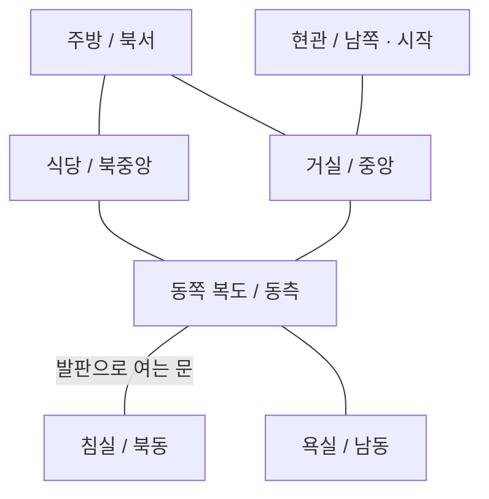

# 별장 1층 배치 제안

이 문서는 배치 확정 전의 설계안입니다. 치수와 배치는 임시 제안이며, 실제 이동 가능한 맵 구현은 배치 확정 후 진행합니다.

## 현재 코드 확인

- src/world.py에 화면 800×600px, 플레이어 충돌 반경 12px, 이동 속도 200px/s와 사각형 벽 8개가 정의되어 있습니다.
- 충돌은 플레이어 중심을 기준으로 한 24×24px 사각형과 벽의 겹침을 검사합니다.
- src/player.py는 X축과 Y축을 따로 검사하므로 벽을 따라 미끄러지듯 이동할 수 있습니다. 대각선 속도는 정규화합니다.
- src/game.py는 고정 화면에 벽과 임시 플레이어를 그립니다. 카메라 스크롤, 방 전환, 가구 충돌, 문 상태, 관측 판정, Watcher와 발판 로직은 개발 예정입니다.
- 기존 타일 규격과 외부 맵 데이터는 없습니다. data/maps와 assets/images/tiles는 준비된 폴더입니다.
- 현재 소스코드를 읽어 확인했으며 이번 작업에서 게임을 실행하거나 이동을 검증하지는 않았습니다.

## 제안 규격

- 타일 한 칸을 32×32px로 제안합니다. 현재 캐릭터 충돌 폭 24px가 한 칸 안에 들어갑니다.
- 문 통과 폭은 최소 2칸인 64px, 좁은 복도의 유효 폭은 3칸인 96px로 잡습니다.
- 수치는 벽과 가구의 충돌 영역을 제외한 통행 폭입니다.
- 기존 1254×1254px 캐릭터 시트는 원본 이미지 크기입니다. 타일 크기와 게임 내 캐릭터 표시 크기는 별도로 결정합니다.
- 초기 구현은 방별 고정 화면과 문 경계 전환을 제안합니다. 방 전환 중 이어지는 추적 처리를 피할 수 있도록 첫 Watcher 퍼즐은 동쪽 복도 한 화면에 배치합니다.
- 복도도 방처럼 독립된 화면으로 다룹니다. 아래 연결도는 실제 축척 평면도가 아닙니다.

## 방의 위치와 연결

북쪽에 주방·식당·침실, 가운데에 거실과 동쪽 복도, 남쪽에 현관을 둡니다.
욕실은 동쪽 복도에서 남쪽으로 갈라지는 작은 공간입니다.

| 공간 | 제안 유효 바닥 크기 | 출입구와 가구 배치 |
|---|---|---|
| 현관 | 10×8칸 | 남쪽 신발장 옆에서 시작합니다. 북쪽 문은 거실로 연결합니다. 코트걸이와 신발장을 벽 쪽에 붙입니다. |
| 거실 | 20×14칸 | 남쪽 현관, 북서쪽 주방, 동쪽 복도로 연결합니다. 소파와 낮은 탁자로 가운데를 나누고 양옆 통로를 확보합니다. |
| 주방 | 12×10칸 | 남쪽 거실과 동쪽 식당으로 연결합니다. 북벽과 서벽에 조리대·싱크대, 모서리에 냉장고를 둡니다. |
| 식당 | 14×10칸 | 서쪽 주방과 동쪽 복도로 연결합니다. 긴 식탁을 중앙보다 위쪽에 두고 아래쪽 주 통로를 확보합니다. |
| 동쪽 복도 | 20×14칸 화면 | 서쪽 거실, 북서쪽 식당, 북쪽 잠긴 침실, 남동쪽 욕실로 연결합니다. 3칸 폭의 굽은 통로와 동쪽의 넓어진 퍼즐 구역을 조합합니다. |
| 침실 | 14×10칸 | 동쪽 복도의 잠긴 문으로만 출입합니다. 침대·협탁·옷장·책상을 서로 다른 벽 쪽에 둡니다. |
| 욕실 | 8×8칸 | 동쪽 복도에서만 출입합니다. 세면대·욕조·변기를 벽에 붙이고 중앙은 비웁니다. |

모든 화면의 문에는 대응하는 목적지 출입구를 지정하고, 도착 지점은 문 안쪽의 비어 있는 바닥에 둡니다.
잠긴 침실 외의 방은 처음부터 탐색 가능하도록 제안합니다.
현관 바깥은 별장 탈출 목표를 표현할 위치로 확보하며, 탈출 조건은 이번 배치안에서 정하지 않습니다.

## 탐색 흐름

1. 현관에서 시작해 넓은 거실에서 기본 이동과 방의 연결을 익힙니다.
2. 동쪽 복도로 들어가 잠긴 침실과 발판을 먼저 발견합니다.
3. 복도에서 욕실을 확인하고 거실로 돌아와 주방과 식당을 탐색합니다.
4. 거실 → 주방 → 식당 → 동쪽 복도 → 거실의 순환 동선으로 복도에 다시 접근합니다.
5. 복도의 Watcher와 발판을 이용하는 퍼즐을 해결하고 침실로 진입하는 흐름을 목표로 합니다.

다른 방 탐색은 공간을 익히는 역할입니다. 열쇠 수집이나 특정 방 방문을 문 개방 조건으로 추가하지 않습니다.
침실 출입의 조건은 기존 압력 발판 기획을 따릅니다.

## 동쪽 복도의 Watcher 퍼즐 공간

- 복도 동쪽을 약 10×8칸의 넓은 영역으로 확보합니다.
- Watcher의 초기 배치 후보는 넓어진 영역의 남서쪽입니다.
- 압력 발판과 침실 문은 북쪽 구역에 가깝게 배치할 후보로 둡니다.
- 플레이어가 Watcher를 유도할 길과 비켜 설 길을 위해 발판 접근부에 최소 3칸 폭을 확보합니다.
- 서쪽 굽은 복도는 시선을 돌리거나 모퉁이를 돌아 관측을 해제할 후보 구간입니다.
- 중앙과 남쪽에는 발판 쪽을 바라볼 수 있는 관측 위치 후보를 2곳 이상 확보합니다.
- 큰 가구는 벽 쪽에 배치합니다. 작은 탁자·의자를 시야 차단물로 자동 취급하지 않습니다.
- 벽에 의한 시야 가림은 미정 사항입니다. 초기 검증은 전방 시선 방향 전환만으로도 관측을 해제할 수 있도록 구성합니다.

관측 거리와 시야각, Watcher의 유인·이동 방식은 아직 미정입니다.
문이 발판을 벗어나자마자 닫히는지, 문턱에서 플레이어를 어떻게 처리하는지도 확인해야 합니다.
따라서 이 문서는 퍼즐의 작업 공간과 배치 후보를 확보한 단계입니다.

특히 Space+WASD는 제자리 방향 전환이므로, 이동 방향과 시선 방향을 항상 독립적으로 조작할 수 있다고 가정하지 않습니다.
발판을 바라보면서 침실 문을 통과할 수 있는 배치인지 확정된 조작으로 검증해야 합니다.
문을 통과하기 전에 관측이 풀리거나 문이 닫힌다면 발판·문·관측 위치를 재배치합니다.
문 잠금 유지, 개방 지연, 새로운 이동 조작을 임의로 추가하지 않습니다.

## 분위기와 가독성

- 바닥은 채도가 낮은 갈색, 벽은 회갈색, 욕실은 낡은 청회색 타일을 제안합니다.
- 거실에는 사용하다 남긴 찻잔, 식당에는 일부만 정리된 식기, 현관에는 가지런하지 않은 신발을 배치할 수 있습니다.
- 주방·식당·거실은 가구 종류와 바닥 영역으로 구분합니다.
- 굽은 복도와 어긋난 출입구로 한 번에 보이는 공간을 제한합니다.
- 출입구와 발판의 윤곽은 주변보다 명확하게 표현합니다.
- 「마녀의 집」과 「Ib」에서 사용자가 지정한 좁고 넓은 공간의 대비와 제한된 시야를 참고하는 방향입니다. 방 연결과 퍼즐 배치는 이 프로젝트용 제안입니다.
- 세부 그래픽과 공포 연출은 기본 동선을 검증한 뒤 다듬습니다.

## 배치 확정 후 검증할 항목

- 현관에서 거실·주방·식당·욕실까지 이동할 수 있고 같은 경로로 돌아올 수 있는지 확인합니다.
- 모든 연결의 양쪽 목적지와 시작 위치가 대응하는지 확인합니다.
- 플레이어가 벽·가구·닫힌 문을 통과하지 않는지 확인합니다.
- 문턱·모퉁이·대각선 이동에서 걸림이나 벽 통과가 없는지 확인합니다.
- 도착 지점이 가구나 벽과 겹치지 않는지 확인합니다.
- 거실·주방·식당·복도의 순환 경로가 연결되는지 확인합니다.
- Watcher의 발판 접근 경로, 플레이어의 회피 통로, 관측 위치를 확정된 이동 규칙으로 검증합니다.
- 발판 위 Watcher를 관측한 채 침실 문을 통과할 수 있는지 확인합니다.
- 먼저 단색 블록으로 동선을 검증한 뒤 가구와 타일 이미지를 적용합니다.
