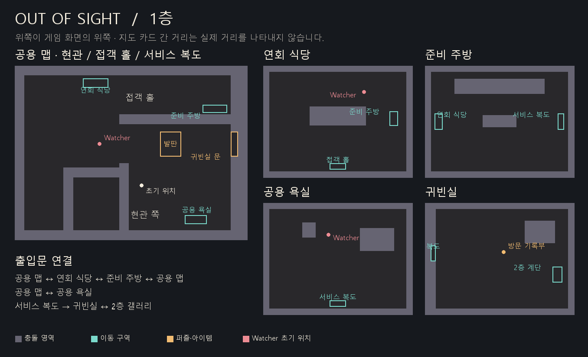
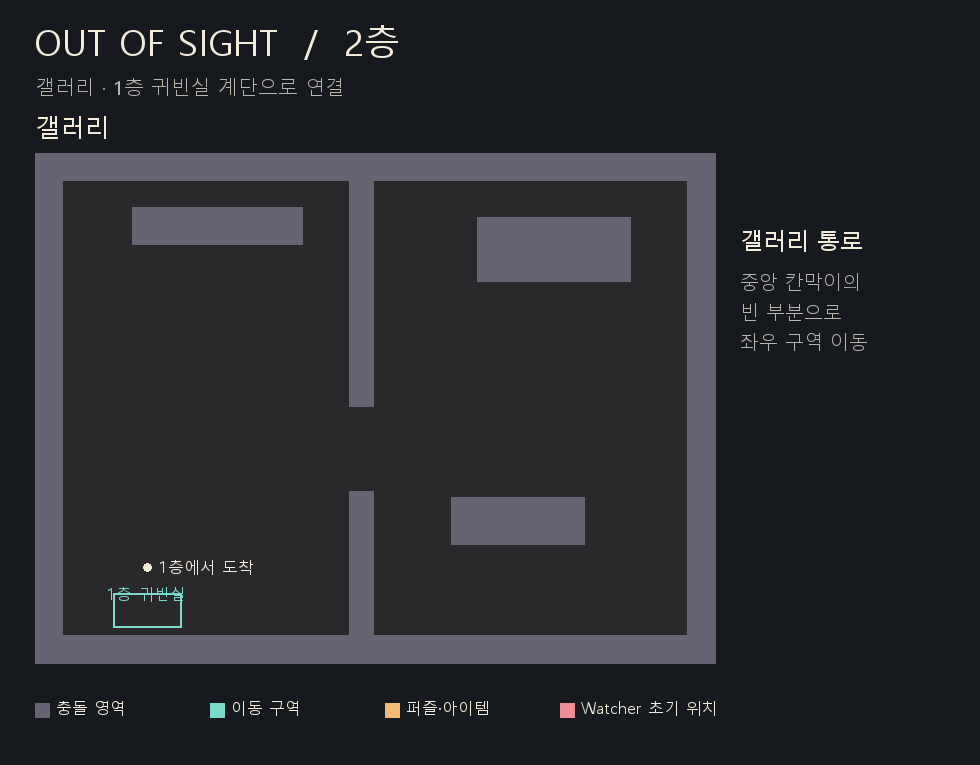

# OUT OF SIGHT 저택 구조와 기믹

현재 게임에서 연결되는 내부는 **1층 공용 맵과 개별 방, 2층 갤러리**입니다. 2층으로 가려면 1층 서비스 복도의 발판 퍼즐을 풀어 귀빈실에 들어가야 합니다.

평면도는 현재 코드의 충돌 영역, 방 전환 위치, 기믹 좌표를 바탕으로 제작했습니다. 회색은 이동을 막는 벽이나 장애물, 청록색은 방 전환 구역, 주황색은 퍼즐이나 아이템, 분홍색은 Watcher 초기 위치입니다. 각 방은 독립된 맵 화면이므로 지도에서 카드 사이의 배치는 실제 방의 거리나 방향을 뜻하지 않습니다.

## 별장 외부와 현관

오프닝에서 별장 앞에 도착하면 직접 이동할 수 있습니다. 초인종을 조사한 뒤 옆 창문에서 동생의 휴대전화를 발견하고, 현관으로 돌아와 안으로 들어갑니다. 복도에서 휴대전화를 주우면 천둥과 정전, 현관문 잠김 연출이 이어집니다. 별장 외부는 오프닝 탐색 구간입니다.

## 1층

아래 그림은 개편 전 배치입니다. 현재의 옷장 위치와 욕실 잠금은 이어지는 표를 기준으로 합니다.

| 공간 | 연결과 기믹 |
| --- | --- |
| 현관·접객 홀·서비스 복도 | 한 화면에서 걸어서 이동합니다. 현관 쪽에 초기 위치가 있고, 서비스 복도에는 압력 발판과 귀빈실 문이 있습니다. 공용 맵에서 식당, 주방, 잠긴 욕실 문으로 이동할 수 있습니다. |
| 연회 식당 | 접객 홀과 준비 주방을 잇습니다. 북동쪽 옷장을 E로 조사하면 최초 Watcher가 드러납니다. 식당 남쪽 문으로 홀에 돌아올 수 있습니다. |
| 준비 주방 | 식당과 서비스 복도 사이를 연결합니다. 공용 욕실 수리 메모와 열쇠 고리를 조사할 수 있습니다. 식당·주방을 거쳐 공용 맵으로 돌아오는 순환 동선이 생깁니다. |
| 공용 욕실 | 열쇠를 챙긴 뒤 서비스 복도에서 문을 조사하면 열립니다. 안에는 물받이와 방문객의 세면도구가 있습니다. |
| 귀빈실 | 서비스 복도의 발판으로 문을 열어 들어갑니다. 내부에서 **E**로 방문 기록부를 얻을 수 있습니다. 서쪽 출입구는 서비스 복도로 돌아가고, 동쪽 계단은 2층 갤러리로 연결됩니다. |

**발판과 귀빈실 문.** 플레이어나 활성화된 Watcher가 발판을 밟으면 문이 열립니다. 발판이 비면 문이 닫히므로 혼자 밟은 뒤 문까지 달리는 방법으로는 통과할 수 없습니다. 문과 발판은 **E**로 조사할 수 있습니다. Watcher를 바라봐 발판 위에서 멈춘 뒤, 이동으로 관측이 풀려도 발판에서 벗어나기 전에 문을 통과하는 것이 기본 풀이입니다.

**Watcher와 정전 이후 시야.** 첫 Watcher는 식당 옷장에서 조우하고, 나머지는 첫 발판 퍼즐을 해결한 뒤 식당과 욕실에 입장할 때 각각 활성화됩니다. 활성화된 Watcher는 통과 가능한 출입구를 통해 방 사이를 이동합니다. 벽에 가리지 않은 전방 90도와 최대 430px 안에서 관측되면 멈추고, 조명 범위 밖에서는 눈만 보입니다. 같은 맵에서 플레이어가 Watcher와 닿으면 게임 오버가 발생합니다.

## 2층

귀빈실 계단을 이용하면 2층 갤러리의 왼쪽 아래에 도착합니다. 중앙 칸막이의 열린 구간을 지나 좌우를 오갈 수 있습니다. 왼쪽 아래의 계단 구역에 들어가면 1층 귀빈실로 돌아옵니다.

2층에는 현재 별도의 조사 대상, 획득 아이템, 전용 퍼즐이나 Watcher 초기 배치가 없습니다. 계단 왕복과 갤러리 탐색이 구현된 상태입니다. 계단도 방 전환 경로에 포함되므로, 열린 경로가 이어져 있으면 활성화된 Watcher가 층을 넘어올 수 있습니다.

## 확인 범위

- 지도에서 벽으로 표시한 영역과 출입구 위치는 [맵 및 퍼즐 코드](../game/first_puzzle.py)를 기준으로 했습니다.
- 코드에서 발판으로 열린 귀빈실 문 진입과 귀빈실 → 2층 갤러리 → 귀빈실 → 서비스 복도 전환을 확인했습니다. 실제 게임 화면에서의 통행과 아트 정합성은 별도 플레이 검증 항목입니다.
